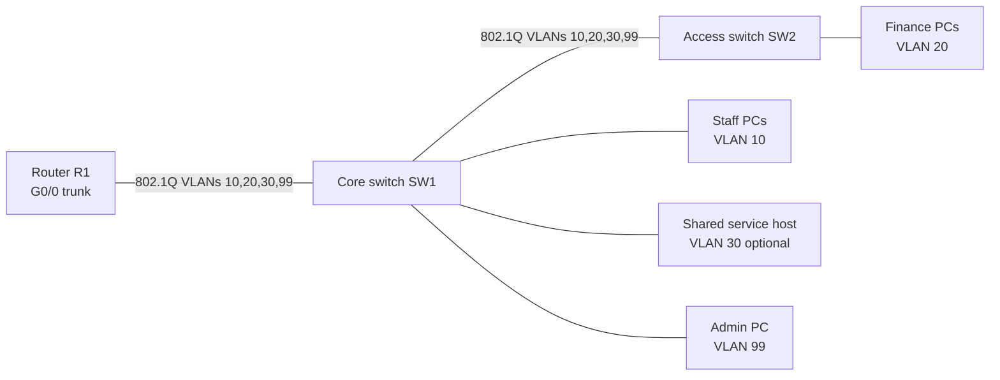

# Lab 2 — VLANs and inter-VLAN routing

Build a small departmental network in Cisco Packet Tracer. Staff and Finance use separate VLANs, a management VLAN is reserved for switch administration, and a router provides inter-VLAN routing. An extended ACL blocks Staff from reaching Finance while allowing other routed traffic.

## Learning goals

- Create and verify VLANs and access ports.
- Carry VLANs over an 802.1Q trunk.
- Configure router-on-a-stick gateways.
- Apply and verify a least-privilege ACL.
- Troubleshoot a wrong access VLAN and a broken trunk.

## Topology

VLAN 30 is included as an optional shared-services network so the ACL example has a service to permit. If you do not add a server, omit VLAN 30 and the corresponding ACL lines. Do not place ordinary user devices in VLAN 99.

## Address plan

| VLAN | Name | Subnet | Gateway | Example endpoints |
|---|---|---|---|---|
| 10 | Staff | 192.168.10.0/24 | 192.168.10.1 | 192.168.10.11, .12 |
| 20 | Finance | 192.168.20.0/24 | 192.168.20.1 | 192.168.20.11, .12 |
| 30 | Services (optional) | 192.168.30.0/24 | 192.168.30.1 | Server 192.168.30.10 |
| 99 | Management | 192.168.99.0/24 | 192.168.99.1 | SW1 .2, SW2 .3, Admin PC .10 |

Use static endpoint addresses for the first verification. DNS is not required for this lab. Replace example addresses if your existing lab uses a different plan.

## Build sequence

1. Place one router, two Layer 2 switches, two Staff PCs, two Finance PCs, and one Admin PC. Optionally add a server.
2. Cable R1 G0/0 to SW1 G0/1; cable SW1 G0/2 to SW2 G0/1. Use straight-through cables or Automatic Connection.
3. Connect endpoints to the access ports listed in the switch configurations. Adjust port numbers if your selected Packet Tracer models differ.
4. Apply `configs/sw1-core.txt`, `configs/sw2-access.txt`, then `configs/r1-router-on-a-stick.txt`. Read interface notes in each file and adapt interface names to your models.
5. Assign endpoint IP addresses, masks, and gateways from the table. For the optional server, enable HTTP if you want to test the permitted shared service.
6. Test same-VLAN communication, gateway reachability, permitted Staff-to-Services traffic, and denied Staff-to-Finance traffic. Record results in `evidence/test-matrix.md`.
7. Create one fault at a time (wrong access VLAN, then trunk issue), record symptoms and diagnostic commands, restore the intended configuration, and retest.
8. Save your own `.pkt` file and capture screenshots of the topology, VLAN/trunk status, routing, ACL counters, and representative successful/blocked tests. Do not commit passwords, account details, or unrelated files.

## Expected policy

- Staff may reach the optional shared service at `192.168.30.10` over HTTP/HTTPS and DNS (TCP/UDP 53), if those services are configured.
- Staff may not initiate traffic to Finance (`192.168.20.0/24`).
- Other Staff traffic is permitted by the example ACL; tighten this policy if your lab scenario requires a default-deny design.
- Finance may reach other VLANs in this learning example. This is intentionally asymmetric and should be reviewed before using the design outside an isolated lab.
- VLAN 99 is for management only. The sample switch configs enable SSH and restrict VTY access to the Admin PC address. Set local credentials only inside Packet Tracer and do not publish real secrets.

## Verification commands

On switches: `show vlan brief`, `show interfaces trunk`, `show interfaces status`, `show ip interface brief`, and `show access-lists` where supported.

On R1: `show ip interface brief`, `show ip route`, and `show access-lists`.

From endpoints, use `ipconfig` and `ping`. For ACL behavior, test from a Staff PC to a Finance PC and to the optional service host. Packet Tracer may need a first retry while it resolves ARP.

## Deliverables

- Completed Packet Tracer `.pkt` file.
- Topology screenshot and VLAN/trunk/routing evidence.
- Sanitized configuration copies.
- Completed test matrix and troubleshooting notes.
- Short report explaining the design, results, fixes, and unresolved limitations.

The configs here are a starting point, not proof that the topology has been run. Record actual observations in the evidence files after building it in Packet Tracer.
